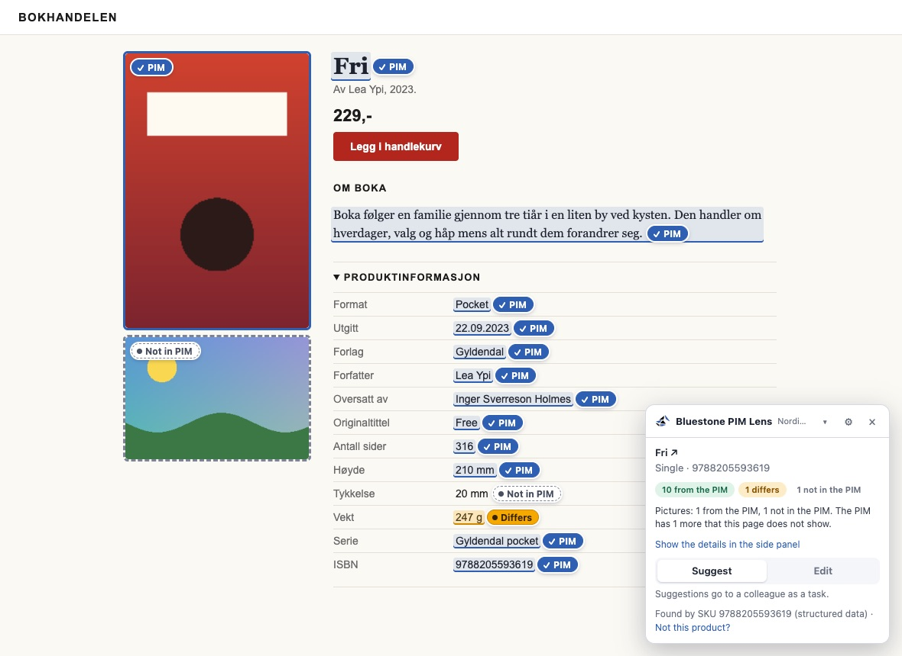
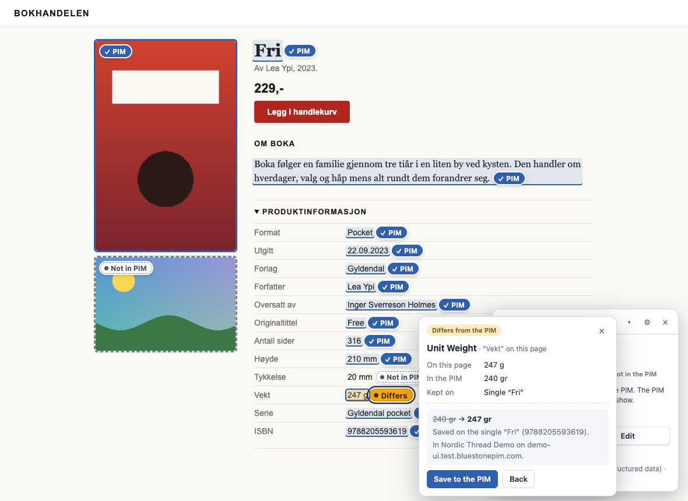
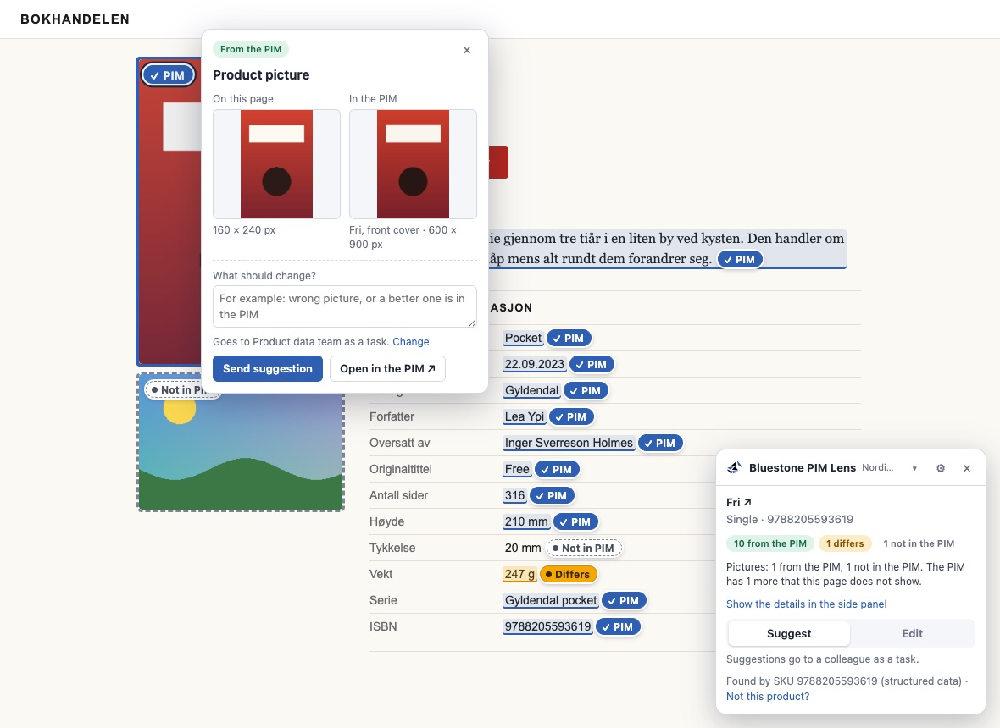
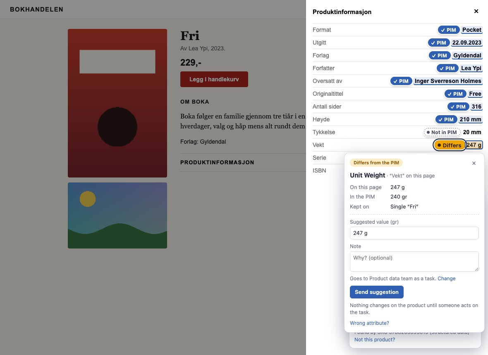

# Bluestone PIM Lens

**An unofficial Labs prototype.** It is a community project, not a Bluestone PIM product, and it comes without support. It works with the Bluestone PIM **Test environment only**.

A Chrome extension that turns any product page into a view of Bluestone PIM. Click the toolbar button on a product page: the Lens finds the product in the PIM and puts a small pill next to each fact on the page, saying whether the value comes from the PIM. Click a pill to see where the value is kept, and change it or suggest a change, without leaving the page.

Version 0.6.2.





## What you see on the page

| Pill | Meaning |
|---|---|
| **PIM** | The value on the page is the value in the PIM. |
| **Differs** | The PIM holds a different value for this attribute. |
| **PIM?** | Probably from the PIM, but the Lens is not sure which attribute. You can confirm it or choose another. |
| **Empty in PIM** | The attribute exists on the product but has no value. |
| **Not in PIM** | Nothing in the PIM matches. You can say which attribute it belongs to. |
| **Saved** / **Suggested** | You saved a new value, or sent a suggestion, in this visit. |

Pills are solid so they stand out on any page, and the value itself is marked in the same colour: a tinted underline for a short value, a bar down the side for a long text. Values the PIM does not hold get only their pill.

Pills are placed on the label and value pairs the page shows (specification tables and lists), on the product's heading, and on longer texts that match a text in the PIM, such as the description. A fact shown twice on a page gets a pill in both places.

A small box in the bottom-right corner shows the product that was found, how it was found, the counts, the mode switch and the settings: organisation, language, which PIM, and who gets suggestions.

The settings also say who is signed in, with **Sign out** beside it. The Lens has no sign-in of its own: it works with the PIM session of your browser. Signing out therefore signs you out of the Test PIM in the whole browser, open PIM tabs included. Sign in to the PIM again, as the same user or another one, and choose **Try again** in the Lens. The side panel has the same thing at the bottom.

## Pictures

The product's own pictures get a pill too, in their top-left corner, and a frame in the pill's colour.



- **PIM**: the picture is one of the product's pictures in the PIM. The card shows both side by side, with the PIM picture's name and size.
- **Not in PIM**: none of the product's PIM pictures looks like it. The card shows the pictures the PIM does have.
- **PIM picture?**: not compared yet (see the permission below).

The corner box sums it up, including how many pictures the PIM has that the page does not show.

A shop serves its own copies of the pictures: renamed, resized and from its own image host. So the Lens does not compare addresses or file names; it compares what the pictures show, using a small fingerprint of each (brightness in a 16 by 16 grid and colour in a 3 by 3 grid). A resized or re-saved copy matches; a cropped picture, or one with a border added, counts as a different picture.

To read a shop's picture the extension needs your permission for that shop's image host. The first time, the corner box says which host and offers **Allow it**; Chrome then asks once. Without it you still see the PIM's pictures in the card and can compare by eye. If Chrome does not show its question from the page, right-click and choose **Allow comparing pictures on this page**.

Pictures cannot be replaced from the Lens. In both modes the card offers a suggestion (a task that names the picture) and a link to the product in the PIM.

Which pictures count as the product's: the ones the page declares as the product's image, or whose description is the product's name. Pictures that link to another page (recommendations, other titles in a series) are left out.

## The side panel: details beside the page, or beside the PIM

The page is the main view. The side panel is for the details, and opens only when you ask for it:

- Click a count in the corner box ("1 differs") to list those facts in the side panel, or **Show the details in the side panel** for the whole comparison.
- Click the product's name in the corner box to open it in Bluestone PIM in a new tab. The side panel opens with it and stays beside the PIM, so you can work through the differences there.

The panel lists every fact on the page against the PIM, differences first, with the PIM's value under the page's value. Buttons at the top narrow the list to Differs, Not in the PIM, Unsure or From the PIM. Clicking a row traces that fact as before.

## Two modes

- **Suggest** (the default). Nothing on the product changes. Your suggestion becomes a task in Bluestone PIM for the person or group you choose, with the product on it. The task says which attribute, what the PIM holds now, what the page shows, what you suggest, your note and the page address. It is due in a week.
- **Edit**. You type the new value, review what will change and where (including how many groups and variants inherit it), and save it to the PIM. A value kept on a parent product is changed there by default; you can choose to change only this product when the parent allows it.

The Lens offers a mode only when your role in the organisation allows it: Edit needs the right to update products, Suggest the right to create tasks. From an Edit card you can always send a suggestion instead.



## Install and try it

You need Chrome 116 or newer and a user in a Bluestone PIM organisation on the Test environment.

1. Download this repository (the green **Code** button, then **Download ZIP**, and unpack it) or clone it.
2. Open `chrome://extensions`, switch on **Developer mode**, choose **Load unpacked** and pick the `ext` folder.
3. Pin the extension to the toolbar (the puzzle-piece button), so its button is always there.
4. Sign in to Bluestone PIM in the same browser: `app.test.bluestonepim.com` or `demo-ui.test.bluestonepim.com`. The Lens uses whichever of the two you are signed in to.
5. Open a product page on a shop that shows products from your organisation, and click the extension's button. Click it again to switch the Lens off. The right-click menu has the same thing: **Show Bluestone PIM data on this page**.

It starts in Suggest mode, so nothing in the PIM changes until you choose Edit yourself.

If the Lens finds no product, type a product number or name in its box. If the button shows a **!**, the page is one Chrome keeps extensions out of (a browser page, the Chrome Web Store, a file).

The side panel can also be opened from the right-click menu: **Open in the side panel instead**.

To update, replace the folder and press the reload button on the extension's card. To remove it, press **Remove** there; that also clears everything it remembered.

## How the product is found

In this order: an identifier on the page as product number; an identifier as the value of an identifier attribute ("Ean", "Item number"); the PIM's own product id, when the page's address holds one; the product name, checked against the facts on the page.

A number that stands right beside the heading with no label ("7001" above the name) is tried as product number too, but counts only when the PIM product with that number also has the page's name.

Pages fed straight from the PIM, such as a content store, are read as well: a page whose main heading is an `h2`, facts written as a label in one element and the value in the next, and the PIM's product id in the address. Such a page often keeps the parent product's address while it shows one variant; the Lens goes by the number the page shows, so it finds that variant, and reads the page again when you choose another variant. A close call shows a list to choose from, and the choice is remembered for that page and organisation. **Not this product?** lists the alternatives.

## How values are matched

By value first (same text, same number, same amount in another unit, same date in another format, a list against several values), then by label. A select attribute matches by the option's value or by its number: a shop that shows "M2" where the PIM shows "Square metre" is the same value, not a difference. Labels in another language are understood for common attributes: "Vekt", "Gewicht" and "Unit Weight" are the same thing. People stored as small records (`{"name": "Lea Ypi", …}`) are compared by name.

When the Lens gets an attribute wrong or cannot find it, choose the right one in the card. That link between the page's label and the attribute is remembered for that shop and organisation, so every later product on that shop is matched the same way.

## Privacy and security

What the extension can reach, and what it does with it:

- **Your PIM session, and nothing else.** The extension has no keys, tokens or passwords of its own and stores none. Its background worker calls the PIM web app's own API with the session of the browser you are signed in with, so every read and write runs with your role's permissions and shows up in the PIM's history as you.
- **Only two addresses.** The session is sent to `app.test.bluestonepim.com` and `demo-ui.test.bluestonepim.com`, fixed in the extension. No other server is contacted: no analytics, no error reporting, nothing to the extension's author. **Sign out** opens two addresses in a background tab and closes it again: the PIM's own sign-out address and the end-of-session address of the Test sign-in service (`idp.test.bluestonepim.com`). The extension itself sends nothing to the sign-in service.
- **A page is read only when you ask.** The extension has no standing access to the sites you visit. A page is read after you click the button or the menu item (Chrome's `activeTab` permission), and only that page. It does not run in incognito windows.
- **The shop page is kept from reading the Lens.** Everything the Lens draws sits in a closed part of the page that the page's own scripts cannot open, and its text is drawn in a way that a script's text search or selection does not reach. The page's own elements are not changed.
- **The shop page is kept from steering the Lens.** The Lens acts only on real clicks and key presses, never on ones a script makes. A button that changes something in the PIM (Save, Send suggestion, Switch organisation, Sign out) works only after it has been fully showing, with nothing drawn over it, for half a second, so a page cannot cover the card and guide a click onto it.
- **What a page says is treated as untrusted.** Text read from a page is only ever shown as text. Before it is used it is cut to a sensible length, and in a task it stays on its own line, so a page cannot write the rest of a task for you. The page's address is taken from Chrome, not from the page.
- **Nothing is saved without a review.** Edit shows what will change, on which product, in which language and organisation, and how many products inherit it, before you save. Suggest never changes the product.
- **A save goes where you read.** Every save and suggestion is tied to the PIM, organisation and language the page was read with. If your session has moved to another organisation since, the Lens refuses and asks you to read the page again.
- **Pictures need one more permission.** To compare a shop's pictures, the extension asks Chrome for access to that shop's image host, by name, when you choose **Allow it**. Pictures are fetched without your cookies; their fingerprints are compared inside the extension and not kept. You can take the permission back on the extension's page in `chrome://extensions`.
- **What it remembers, in this browser only:** which product a page turned out to be (the page's address and the product's id, for the last 500 pages), your label links, the chosen mode, language and PIM, and who gets suggestions. No page content and no PIM values. Scripts running in web pages cannot read it.

### What a hostile page could still do

The Lens runs on pages you choose, usually your own shop. A page that sets out to attack it is limited to this:

- It can tell that the Lens is on, and work out which of the values it shows match the PIM (from the size of the pills). By changing its own values it could test guesses against the PIM this way, so the Lens reads a changed page again by itself only after you clicked or typed on the page, and at most 20 times a minute.
- While a card is open in Edit mode, it can test guesses against the value in the card's input field, and it can see what you type into the Lens's fields.
- If the page had already broken out of Chrome's own protections (a browser exploit), it could send requests as the Lens and reach what your PIM role can reach in the Test environment.

A sturdier design would draw the cards in a frame that belongs to the extension, which the page cannot touch at all. That is not built yet. Until then: use the Lens on shops you trust.

Found a security problem? See [SECURITY.md](SECURITY.md).

## What is verified, and what is not

| | |
|---|---|
| 57 automated tests (`npm test`) | Pass. Matching (a select by its option's value or number among it), finding the product (also on a page fed straight from the PIM), Edit (review and save), Suggest (task, assignee, product on the task), roles, label links, organisation switching, signing out (reported as done only when the PIM says nobody is signed in), pictures, a save staying in the language and organisation the page was read with, and how the service handles odd or hostile messages, all against a stand-in PIM. |
| 53 checks in a real browser (`npm run test:browser`) | Pass, in Chromium 147. The extension is loaded unchanged and used with real clicks against a stand-in PIM at the PIM's own addresses: pills, cards, a suggestion, a save, the side panel request, pictures compared in the background worker, facts in a modal drawer, a shop that changes product without reloading, a page laid out like a content store (and another variant chosen on it), signed out, signing out and another user signing in, a PIM that keeps its session, the background worker stopping and starting, and a PIM that does not answer. Also what a page can do to it: a page script cannot open the Lens, find or select its text, click its buttons, or get a covered button to act. |
| An independent code review | A second reviewer read all the code for security and reliability problems after the first round of fixes. What it found is fixed or listed above under "What a hostile page could still do". |
| A real Test organisation, read only | Finding books from a real shop's page data, the comparison (17 of 17 facts confirmed on one book; real differences flagged on others; empty attributes reported as empty), roles, the list of people for suggestions, history and the save review. |
| A real Test organisation, one write | Suggest mode created one real task: the PIM answered with the new task's id, the product was put on it, and the task read back with the right title, assignee, due date, language and description. The product itself was unchanged. |
| **Not verified** | Against a real PIM: saving from Edit mode, the picture comparison (the list of a product's pictures and the PIM's thumbnail address follow the documentation only), switching organisation, and signing out. For signing out, the end-of-session address is the one the Test sign-in service publishes, but the PIM app's own sign-out address (`/logout`) is an assumption. If it is wrong and the PIM keeps its session, the Lens says so and opens the PIM for you to sign out there; it does not report that you are signed out. In Chrome itself: answering Chrome's permission question for an image host (the test only shows that the question is reached), and the side panel as you see it (the test shows that Chrome accepts the request to open it). |

## Known limits

- Test environment only. The production PIM is left out on purpose while this is a prototype.
- Sign out ends your PIM session in the whole browser, not only in the Lens, and covers both Test PIMs.
- A shop page has to show the product as label and value pairs for the Lens to have something to mark. Pages inside frames are not read.
- Facts that are not label and value pairs (subject tags, the author line under the title, prices) get no pill.
- Edit handles text, whole numbers, decimals and single-select attributes. Other kinds can be suggested, or opened in the PIM.
- Up to eight pictures per page and eight per product are compared. Videos and documents are ignored.
- A picture is taken as the product's own when the page declares it so or its description is the product's name. On a page that does neither (a content store, for one), pictures are not compared.
- A shop that crops its pictures or adds a border will show "Not in PIM" for pictures that are in the PIM.
- One task per suggestion. Several suggestions on one product make several tasks.
- The page does not change after a save: it shows the new value once the shop has picked it up from the PIM.
- On a page that redraws itself heavily, pills can lag a moment behind. When a shop moves to another product without reloading, the Lens reads the new page a second or two later.
- While a page shows a modal dialog, the Lens moves inside that dialog. If a shop builds its dialogs in an unusual way, pills there may not be clickable.

## Develop

There is no build step: the `ext` folder is the extension.

```
npm test                 # 57 unit tests, no dependencies
npm install
npx playwright-core install chromium
npm run test:browser     # the extension in a real Chromium, against a stand-in PIM
```

The browser test needs Chromium, not Google Chrome: Chrome no longer loads an extension from the command line. Set `HEADED=1` to watch it.

A simulator runs the on-page view and the side panel in an ordinary browser tab, with a stand-in PIM. From the repository root, start any static server (`python3 -m http.server 8766`) and open:

- `http://localhost:8766/test/shop/book.html?lens`: a Norwegian bookshop page against attributes named in English
- `http://localhost:8766/test/shop/book-drawer.html?lens`: the same with the facts in a modal drawer
- `http://localhost:8766/test/shop/index.html?lens`: a variant that inherits from its group and family
- `http://localhost:8766/test/shop/no-sku.html?lens`: no product number, so a list to choose from
- `http://localhost:8766/test/harness/sim.html`: the side panel beside a shop page
- Add `&viewer` (a role that cannot edit), `&notasks` (cannot create tasks), `&signedOut` or `&askimages`.

| File | What it is |
|---|---|
| `ext/content/lens.js` | The on-page view: pills, cards, the corner box. |
| `ext/src/service.js` | Answers the on-page view: find, compare, details, save, suggest. Runs in the background worker. |
| `ext/src/page-extract.js` | Reads identifiers, label and value pairs, the heading and longer texts from a page. |
| `ext/src/match.js`, `trace.js`, `inspect.js`, `pim.js` | Matching, inheritance, finding the product, the PIM client. |
| `ext/src/imagehash.js` | Picture fingerprints and their comparison. |
| `ext/background.js` | Toolbar button, right-click menu, organisation switching, signing out. |
| `ext/panel/` | The side panel: the detail view. |
| `test/` | Tests, the stand-in PIM (`mock-pim.js`), test shop pages, the simulator (`harness/`) and the browser test (`e2e/`). |

## Licence

MIT, see [LICENSE](LICENSE). "Bluestone PIM" and its logo belong to Bluestone PIM.
